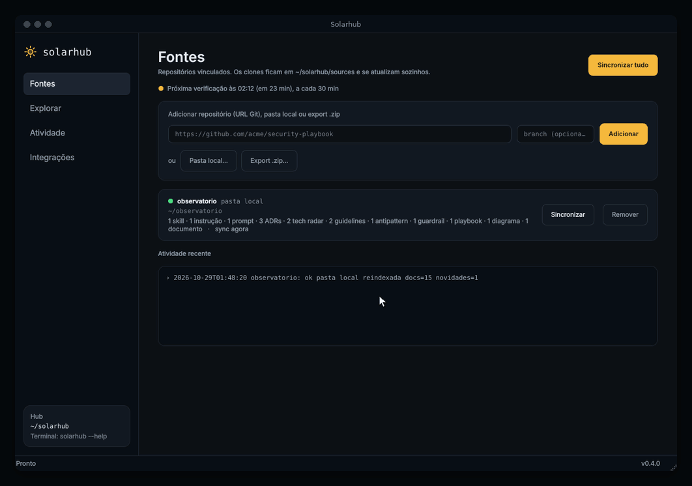
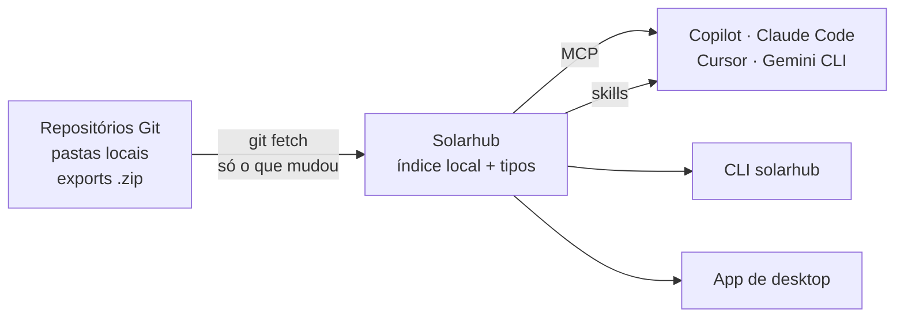

<p align="center">
  
</p>

<h1 align="center">Solarhub</h1>

<p align="center">
  <b>O conhecimento de engenharia do seu time, sempre atualizado, dentro do seu agente de IA.</b><br>
  ADRs, guardrails, guidelines, playbooks e skills dos seus repositórios Git, entregues ao
  GitHub Copilot, Claude Code, Cursor e Gemini CLI.
</p>

<p align="center">
  <a href="https://github.com/ElioGlock/solarhub/actions/workflows/ci.yml"></a>
  <a href="https://github.com/ElioGlock/solarhub/releases"></a>
  <a href="LICENSE"></a>
  
  
  
</p>

<p align="center">
  
</p>

## Por que

Agentes de IA escrevem código rápido, mas não conhecem as decisões do seu time. Eles paginam com offset quando o
ADR manda cursor, escolhem a biblioteca que o tech radar marcou como "evitar" e passam por cima do guardrail que a
CI vai barrar. Colar documentos no prompt não escala, e as decisões mudam toda semana.

O Solarhub resolve isso no seu computador: vincula os repositórios onde o time registra esse conhecimento, mantém
tudo atualizado sozinho e entrega a cada ferramenta de IA no formato que ela entende.

```text
você:   "Crie o endpoint de pedidos usando como referência o adr:14 e a skill api-standards"
agente: → solar_get_adr("14") → solar_get("skill:api-standards") → solar_check_antipatterns(...)
        "Implementei com paginação por cursor (ADR-014, accepted; substitui ADR-009), seguindo os
         guardrails da equipe. Fontes: adrs@7be03d1"
```

## O que ele faz

- **Vincula sem clonar à mão.** Repositórios Git (públicos ou privados, com as suas credenciais), pastas locais ou
  exports `.zip` do Confluence/Notion. Atualiza sozinho e baixa só o que mudou.
- **Organiza por tipo de artefato.** ADRs, Tech Radar, Guidelines, Antipatterns, Guardrails, Fitness Functions,
  Playbooks, Diagramas C4, Mapa de Contextos, Instruções, Prompts e Skills. Reconhece pela pasta, pelo nome, pelo
  cabeçalho do arquivo ou pelo conteúdo, e sugere abas para repositórios fora do padrão (você aprova).
- **Entrega para cada ferramenta.** Servidor MCP, skills publicadas nas pastas que Copilot e Claude Code leem,
  comando `solarhub` no terminal e um app de desktop.
- **Diz o que vale.** ADR substituído não vale, guardrail é obrigatório, item do radar em "evitar" não deve ser usado.
  O agente recebe essas regras junto com o conteúdo.
- **Mostra o que mudou.** ADR novo, ADR que virou *superseded*, skill nova: no app, no terminal, para o agente e
  numa notificação do sistema.
- **Tudo local.** Sem conta, sem servidor do Solarhub, sem telemetria. Código aberto (MIT).

## Como funciona



Detalhes e decisões de arquitetura em [ARCHITECTURE.md](ARCHITECTURE.md).

## Experimente

Você precisa do **git** e do **[uv](https://docs.astral.sh/uv/getting-started/installation/)** (gerenciador de
pacotes Python; ele baixa o Python sozinho se faltar).

```bash
uv tool install "solarhub[app] @ git+https://github.com/ElioGlock/solarhub"
solarhub app
```

Instala direto do código, sem clonar, e abre o app: um assistente pede as URLs dos repositórios e as ferramentas de
IA a integrar. Na primeira vez ele cria o atalho no menu e deixa o comando `solarhub` disponível no terminal (se o
terminal não achar o comando, rode `uv tool update-shell` uma vez).
No Ubuntu/Debian, se a janela não abrir: `sudo apt install libegl1 libgl1 libxkbcommon-x11-0 libxcb-cursor0`.

| | |
|---|---|
| Atualizar | `uv tool upgrade solarhub` (o app avisa quando sai versão nova) |
| Fixar numa versão | acrescente a versão no fim da URL: `…/ElioGlock/solarhub@v0.4.0` |
| Remover | `solarhub uninstall` e depois `uv tool uninstall solarhub` |
| Sem uv | `pipx install "solarhub[app] @ git+https://github.com/ElioGlock/solarhub"` funciona igual |

<details>
<summary><b>Prefere um executável pronto?</b> AppImage (Linux) e .zip (Windows), sem Python nem uv</summary>

| Sistema | Download | Como abrir |
|---|---|---|
| Windows 10/11 | [Solarhub-windows-x64.zip](https://github.com/ElioGlock/solarhub/releases/latest/download/Solarhub-windows-x64.zip) | Extraia em `%LOCALAPPDATA%\Programs\Solarhub` e abra o `Solarhub.exe` |
| Linux x86_64 | [Solarhub-x86_64.AppImage](https://github.com/ElioGlock/solarhub/releases/latest/download/Solarhub-x86_64.AppImage) | Guarde em `~/Applications`, `chmod +x` e abra |

Gerados automaticamente a cada versão, com o mesmo código. Quando sai uma versão nova, o app mostra
**Atualizar para vX**: um clique baixa, confere o SHA-256 e reabre. O executável do Windows ainda não tem assinatura
digital, então o SmartScreen pode avisar (*Mais informações → Executar assim mesmo*). No Ubuntu 22.04 ou mais novo, o
AppImage pode pedir `sudo apt install libfuse2`.
</details>

## Integrações

| Ferramenta | Como recebe o conhecimento |
|---|---|
| GitHub Copilot no VS Code | MCP (`mcp.json` do usuário) e skills em `~/.copilot/skills` |
| GitHub Copilot CLI | MCP (`~/.copilot/mcp-config.json`) e skills em `~/.copilot/skills` |
| Claude Code | MCP (`claude mcp add`) e skills em `~/.claude/skills` |
| Cursor | MCP (`~/.cursor/mcp.json`) |
| Gemini CLI | MCP (`~/.gemini/settings.json`) |
| Qualquer editor ou terminal | `solarhub search`, `solarhub get adr:2`, `solarhub context "tarefa"` (pacote para colar no prompt) |

O Solarhub detecta o que está instalado e só configura o que você marcar.

## O que ele altera no seu computador

Antes de instalar uma ferramenta que mexe na configuração das suas outras ferramentas, você deve saber exatamente o
quê. Tudo fica registrado em `~/solarhub/.state/manifest.json` e sai com a desinstalação.

| Onde | O quê |
|---|---|
| `~/solarhub/` | configuração, clones das fontes, índice de busca, histórico |
| Pastas de skills (`~/.copilot/skills`, `~/.claude/skills`) | links para as skills das fontes + a skill `solarhub`, que ensina o agente a consultar |
| Configuração MCP das ferramentas marcadas | entrada `solarhub` (com cópia de segurança do arquivo antes de editar) |
| Sincronização automática | timer do systemd do usuário (Linux) ou tarefa oculta no Agendador (Windows) |
| Menu e terminal | atalho "Solarhub" e comando `solarhub` (bloco marcado no `~/.profile` ou PATH do usuário no Windows) |

```bash
solarhub uninstall        # remove tudo o que o Solarhub criou, inclusive ~/solarhub (--keep-data mantém o hub)
```

Depois, `uv tool uninstall solarhub` (ou apague o AppImage / a pasta do `.zip`). Num clone, `./uninstall.sh` (ou
`.\uninstall.cmd`) faz tudo e também apaga o `.venv`. O Solarhub nunca mexe em skills ou configurações que não criou. Mais em
[SECURITY.md](SECURITY.md).

## Participe

O Solarhub é um projeto aberto e em construção, e a ideia é crescer com quem usa.

- **Rodar a partir do código e mexer:**
  ```bash
  git clone https://github.com/ElioGlock/solarhub && cd solarhub
  source app        # Linux; no Windows: .\app.cmd
  ```
  Cria um ambiente isolado dentro da pasta e abre o app com o seu código. Testes: veja [CONTRIBUTING.md](CONTRIBUTING.md).
- **Bons pontos para começar:** issues com o rótulo
  [`good first issue`](https://github.com/ElioGlock/solarhub/labels/good%20first%20issue). Novos tipos de artefato,
  regras de reconhecimento pelo conteúdo e integração com outras ferramentas de IA são partes isoladas do código.
- **Conte como seu time organiza o conhecimento** (pastas, formatos de ADR, guardrails) nas
  [Discussions](https://github.com/ElioGlock/solarhub/discussions): é o que guia o reconhecimento automático de tipos.
- **Bugs e ideias:** [issues](https://github.com/ElioGlock/solarhub/issues).

## Documentação

- [Guia completo](docs/guia.md): app, comandos, referências no prompt (`adr:14`, `guardrail:nome`), como cada tipo é
  reconhecido, `solarhub.toml`, perfis por projeto, busca por significado, propostas de ADR por PR, servidor MCP.
- [Arquitetura](ARCHITECTURE.md): como as peças se encaixam e por quê.
- [Changelog](CHANGELOG.md) · [Como contribuir](CONTRIBUTING.md) · [Segurança](SECURITY.md)

## Plataformas

| | |
|---|---|
| Linux | suportado (testado em Ubuntu; precisa de interface gráfica para o app) |
| Windows 10/11 | suportado |
| macOS | ainda não (contribuições bem-vindas) |

## Próximos passos

- Interface e documentação em inglês.
- Suporte a macOS.
- Publicação no PyPI (`pipx install solarhub`).
- Integração com mais ferramentas de IA conforme elas adotarem MCP e skills.

## Licença

[MIT](LICENSE) © Elio Junior
